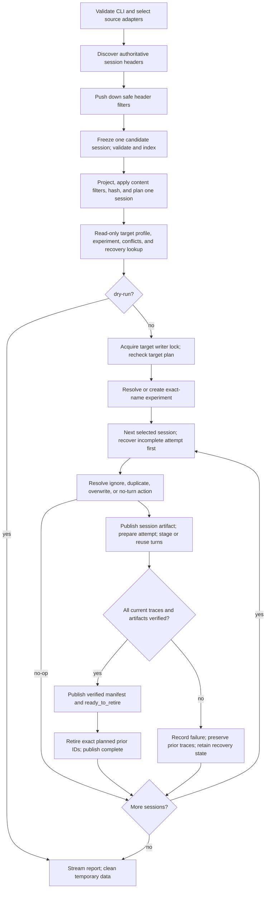

# Architecture: Coding-Agent Session Importer for MLflow

**Status:** Target implementation blueprint | **Contract:** [requirements.md](requirements.md) | **Reviewed:** 2026-11-04

## 1. Design and implementation baseline

Use a **snapshot → indexed plan → sequential import** pipeline. Five built-in adapters supply source facts; shared functions reconstruct turns, select sessions, redact, and hash. One MLflow boundary handles persistence and reconciliation. One source session groups multiple traces; one persisted user turn produces one trace.

This checkout contains no source package. `pyproject.toml` pins Python `>=3.11`, `mlflow==3.17.2`, and distribution `mlflow-import` version `0.1.0`. Implement the sole console entry point, `mlflow-import = mlflow_import.cli:main`, in the `mlflow_import` Python package; provide no alternate importer command or Python-package shim. Read legacy `opencode.*` ownership metadata and `opencode-mlflow.result.v1` through one versioned compatibility decoder.

Support is conditional on fixture-backed source schemas and a tested target profile. The API bindings in Section 6 are concrete design choices, not a claim of existing conformance. A profile must verify historical timing, complete trace payloads, mutable tags, artifact upload/read-back/listing, exact-ID deletion, and crash recovery. Unsupported source/target profiles fail before writes. A read-only preflight cannot prove write permission; the first denied write remains an operational failure and must preserve prior traces.

### Fixed decisions

| Decision | Implementation constraint |
| --- | --- |
| Two phases | Discover only authoritative session headers, push down safe filters, then freeze and plan one selected session at a time before MLflow mutation. Push down only filters proven equivalent on authoritative source metadata. |
| Small boundaries | Typed source adapter protocol, explicit registry, plain immutable DTOs, shared pure projection functions, one target implementation. No plugin framework, ORM, or dependency-injection framework. |
| Serial writes | Process one session and turn at a time. Continue later items after a failure. Serialize competing importer processes as described in Section 8. |
| Persisted conversation | Use the authoritative persisted resume/active path. Preserve alternate branches and original replay records in artifacts. Never guess inaccessible in-memory state. |
| Fidelity | Complete root values and source-derived timing, outcomes, usage, costs, and identities; unknown permitted data remains in artifacts. No truncation or run-only fallback. |
| Privacy boundary | Adapter exclusions before staging; optional outbound secret and user-identity redaction before serialization. Selection uses allowed source facts, independent of redaction. |
| Incremental reconciliation | Stable user-record turn keys; separate turn and session digests; reuse unchanged trace IDs and turn maps. Verify before retiring exact prior IDs. |
| Bounded work | Disk-backed record offsets/ancestry/turn indexes, fixed streaming passes, paginated target queries, spooled artifacts/results. Only the verified API's one-turn payload may require turn-sized RAM. |

## 2. Pipeline and write boundary



**Phase 1 — no target writes:** Validate the CLI semantics in requirements §§6–7, discover sources, select authoritative representations, and build only a bounded session-header index. Apply safe header filters before reading transcript bodies. Then process candidates serially: freeze the associated records/sidecars for one session, validate them, build that session's disk index, apply model/turn filters that require session content, derive its plan item, and release its temporary session data before advancing. A full-source transcript snapshot is prohibited. Store the ordered plan on disk as session items, or spool each completed item into the final ordered plan without retaining all session bodies. Read-only target checks resolve the exact experiment name, required capabilities, canonical/legacy conflicts, and unfinished attempts. A dry-run reports expected actions without acquiring a writer lock, creating an experiment, uploading anything, or repairing state. If recovery is required, report it as pending rather than pretending the forecast is an exact execution outcome.

Recovery lookup is scoped by requested harness/source namespaces and optional session ID, not by current content filters. Even a zero-match plan must report excluded unfinished attempts with exit `1` and the filter relaxation needed to resume; it must not mutate excluded sessions or silently declare a clean no-op. A dry-run likewise reports this unresolved state without repairing it.

**Phase 2 — frozen source reads only:** Acquire the writer lock, recheck target conflicts/recovery and capabilities, and resolve/create the experiment once. On a creation race or lost response, look up the exact name before retrying; reject deleted experiments rather than restoring them implicitly. Report the experiment ID before trace imports. Iterate the plan serially, following the single state machine in Section 8. If the target plan changes, repeat the relevant read-only checks before that session's first write. Cleanup private temporary files on handled success, failure, interrupt, and dry-run; never touch source files.

## 3. Source boundary, snapshots, and indexes

### Adapter contract

```python
from collections.abc import Iterable, Iterator, Mapping
from pathlib import Path
from typing import Protocol


class HarnessAdapter(Protocol):
    name: str

    def default_sources(self, env: Mapping[str, str]) -> Iterable[SourceCandidate]: ...
    def detect(self, source: SourceCandidate) -> SourceFormat | None: ...
    def candidates(self, source: SourceCandidate) -> Iterator[CandidateRef]: ...
    def freeze(self, candidates: Iterable[CandidateRef], temp_root: Path) -> FrozenSource: ...
    def sessions(self, source: FrozenSource) -> Iterator[SessionRef]: ...
    def records(self, session: SessionRef) -> Iterator[SourceRecord]: ...
```

The registry contains `opencode`, `claude`, `codex`, `pi`, and `gemini`. Each adapter owns paths/overrides, detection, schema versions, authoritative-record precedence, safe field exclusion, file/sidecar association, source order, and persisted branch/replay semantics. `CandidateRef` contains only enough authoritative header metadata for safe pruning; its values are rechecked against the frozen view. It is not permission for a shared CLI to query harness internals. For databases, enumeration and copying use the same read transaction. An explicit source must match the requested harness, or exactly one adapter when no harness is given.

`SourceCandidate` is a local locator and stable source namespace. `SourceFormat` names the supported schema. `CandidateRef` contains only authoritative session-header metadata and a locator; it must not contain transcript bodies or sidecar contents. `FrozenSource` owns one restricted session snapshot and its validated inventory. `SessionRef` points only into that session snapshot. `SourceRecord` exposes ID, type, source order, timestamps, parent/branch/call links, normalized model/tool/outcome/usage fields, and the complete permitted raw payload. Adapters provide facts; the shared projection computes model indexes, logical turns, counts, fingerprints, and the `SessionSummary` exactly once. Do not implement five separate turn counters or rescanning `summarize()` methods.

### Snapshot rules

1. **SQLite:** Open `mode=ro`, enable query-only operation, and hold a committed WAL-aware read transaction while enumerating session headers and freezing one selected session. The global discovery pass may read only allowlisted session-header columns and must not read transcript, sidecar, blob, credential, account, token, or share values. Every record query must carry the selected session identity (or an equivalent indexed parent/session predicate); a `--session` filter must never scan or copy unrelated transcript rows. Do not run migrations, checkpoint, or back up the whole database including credentials. Require the existing WAL companions/access needed for a genuinely read-only open; do not use `immutable=1` to bypass WAL consistency on a live source.
2. **Files:** Capture the candidate inventory and only the selected session's associated record/sidecar set. Stream through schema-aware exclusion into owner-only temporary storage. Compare file identity, size, mtime, and streaming content digests with a second source read; recheck the eligible inventory and sidecars after the copy. Retry changed candidates under the shared bounded budget. A new eligible session invalidates the plan; changes confined to provably excluded sessions do not. Persistent candidate churn fails before writes. This is a stable per-session view, not a global filesystem snapshot.
3. **Exclusions:** Never query credential/account/token/share table values. Omit known secret-bearing file records/fields before canonicalization, staging, selection, or hashing. Retain original bytes only when the complete record is permitted; mixed records retain every allowed field in a projection, never their excluded raw copy. Reject schemas whose required boundaries cannot be separated safely. Ordinary allowed transcript text may still contain secrets; local staging is restricted but unredacted even with `--redact`. Do not promise secure erasure.
4. **Unknown/malformed data:** Preserve unknown fields and undecodable non-critical values as tagged raw text/bytes with warnings. Required identity/order/ancestry corruption fails validation before writes. Preserve unambiguously associated event/todo/instruction/subagent/sidecar records; report unassociated records rather than guessing. Source records preceding the first user prompt remain in the artifact without creating a turn.

### One disk-backed index, one common projection

Keep transcript bodies in frozen sequential spool files. A temporary SQLite catalog stores only session summaries and indexes: source ID/order, parent ID, spool offset/length, active-path ordinal, turn key, model identities, expected digests, and target reconciliation references. Index `(session_id, record_id)`, `(session_id, parent_id)`, and `(session_id, turn_key, ordinal)`; use uniqueness constraints to reject duplicate IDs. This is a locator/index store, not a second transcript database. Set bounded SQLite cache/batch sizes and stream cursors instead of `fetchall()`.

For a tree, walk from the authoritative persisted head through indexed parents, recording visited IDs and path ordinals on disk. Reject cycles, unresolved required parents, or an ambiguous head. Traverse the indexed path in conversation order, opening a turn only at a persisted primary user prompt. For replayable logs, the adapter supplies effective records plus links to original updates; replay uses the same disk-backed working store, not a session-sized Python graph. Subagent user messages do not start primary turns. Tool-only/system/synthetic/lifecycle records do not start turns.

Use the initiating user record's stable source ID as the turn key; the current turn index is display metadata, not identity. An adapter without IDs must document a deterministic locator/occurrence fallback and the edits that invalidate it. Do not use array index alone when an authoritative stable ID exists. Resolve turn record ranges through the index in phase 2; never rescan the session once per turn. Apply source/header filters as safe pushdowns, and evaluate model/turn-count filters over the full required projection. Model matching includes permitted inactive branches; turn counting uses only the primary persisted path. Redaction cannot alter selection.

The filter access contract is explicit: session ID, creation time, and directory filters operate on the global header index; model filters may use an adapter-provided header/model index but must read only candidate sessions for verification; minimum-turn filters use the candidate session's disk index. No filter is allowed to trigger a source-wide transcript scan. A session is released from temporary storage after its plan item and required recovery evidence are spooled.

Order sessions by normalized creation instant, native session ID, then harness/namespace as a tie-breaker; order records by authoritative source sequence, with timestamp/stable ID as documented tie-breakers. Missing creation time excludes a candidate under a time bound with a warning; without a bound, sort it after known times using stable identity. Do not substitute update time.

## 4. Identity, canonicalization, and change scopes

The source identity is `(harness, source_namespace, native_session_id)`. The adapter derives its namespace from a persisted store/profile identity where possible; otherwise use a versioned SHA-256 of the normalized owning source root. Explicit files and default discovery must resolve the same owning root; archives and alternate representations of that store share its namespace. A locator-derived namespace changes when the store moves; document that limitation, never expose the absolute locator, and reject indistinguishable roots. Encode `mlflow.trace.session` as a versioned compact JSON tuple, identically in every invocation; retain the native ID in `mlflow_import.session_id`.

Conflict discovery searches the canonical identity **and** fixture-backed legacy aliases: legacy `opencode.*` fields and plugin/native-only `mlflow.trace.session` values. An alias is usable only when persisted harness/source evidence or the complete candidate identity index makes its association unambiguous. Explicit contradictory metadata disqualifies it; unresolved ambiguity fails preflight. A matching session ID does not establish ownership. Reuse/refresh requires the full recognized importer marker and identity fields. Overwrite may retire foreign aliases only within that resolved conflict set.

One shared canonicalizer produces UTF-8 JSON with sorted object keys, compact separators, source-order arrays, normalized UTC values for normalized timestamp fields, and explicit JSON nulls where present. Preserve missing-versus-null and raw source timestamps separately. Reject/non-destructively wrap non-JSON numeric/raw values instead of silently coercing them. Include canonicalization/schema/projection versions. Hash incrementally while streaming each record; never build a full-session dictionary or serialized string just to hash it.

| Value | Inputs and role |
| --- | --- |
| `source_fingerprint` / session revision | All permitted exported records, inactive branches, turn boundaries, and non-locator session semantics; no target IDs, attempt IDs, or artifact paths. |
| `metadata_fingerprint` | Current outbound session metadata, directory/path, counts/aggregates, and each turn's current display index; excludes generated paths/IDs. Diff per-field values before tag writes. |
| `turn_fingerprint` | Stable turn key and complete outbound trace payload/status, immutable native user/source projection, record order and source timing, mapping version and privacy profile; excludes refreshable session-wide metadata, display index, generated trace/span IDs, and artifact paths. |
| `artifact_sha256` | Exact serialized artifact bytes, including any generated trace/span map; stored outside those bytes. |
| `attempt_id` | Unique durable write-attempt ID, allocated once in `prepared`; recovered by source/instance scope, independent of the current source fingerprint. It is not a payload fingerprint. |
| `import_instance_id` | Additional unique identity for a duplicate copy; all its trace, artifact, and recovery lookups are instance-scoped. |

In redacted mode, exported payload fingerprints and artifact digests cover **only** redacted projections and include mode/profile version. Never persist a digest of unredacted transcript content in that mode. Transient source-byte digests used solely for snapshot stability are discarded. Reconciliation IDs are exempt from redaction and must contain no credential material; user-identity metadata is not exempt. Privacy mode changes payload revision, not source identity.

## 5. Trace and span mapping

Each trace has native `mlflow.trace.session` metadata, immutable source identity/turn/projection provenance, and namespaced importer fields. At minimum carry `mlflow_import.importer=mlflow-import`, `harness`, `source_namespace`, `session_id`, `turn_key`, `turn_index`, `source_fingerprint`, `turn_fingerprint`, `metadata_fingerprint`, `source_schema`, `importer_version`, privacy profile, attempt/instance IDs where applicable, and canonical artifact references.

Use native request metadata for immutable session identity and available native user/source fields. Use **mutable trace tags** as the authoritative storage for refreshed importer fields and current session metadata; do not shadow them with stale immutable copies. Refresh means set changed fields **and delete removed managed fields** while preserving unrelated tags. Keep full metadata in the session artifact; oversized nonidentity tag values use an explicit overflow/reference marker. Check the pinned profile's field lengths before writes: identity truncation is a compatibility error, and long artifact URIs must use short experiment-relative keys. A trace's importer version records its trace-producing implementation; artifact/mapping versions have separate provenance.

Set native `mlflow.source.name` and the normalized session/trace `source` to
`HarnessAdapter.name`: `opencode`, `claude`, `codex`, `pi`, or `gemini`. Apply
the same mapping for explicit paths and default discovery in both privacy modes.
Keep input locators, namespace/fingerprint, model/provider, importer provenance,
and Git metadata in their own fields. Populate native user fields only from
permitted source facts after Section 9's user-identity masking; prevent SDK/OS
defaults from injecting an unredacted user, including through `mlflow.user`.
Include the actual immutable native user/source projection in turn verification
and hashing. A change requires verified trace replacement under Section 8,
rather than a tag refresh that leaves the old immutable value visible.

| Source information | MLflow projection |
| --- | --- |
| Primary user prompt/final assistant result | Complete structured root input/output; no assistant result means null output, never tool output masquerading as the response. Multipart values remain structured. |
| Source timestamps | First user timestamp and last record/completion timestamp determine trace start/end when available; normalize declared units. Preserve absent/invalid timing and raw values; any API-required fallback is explicitly marked synthetic, never reported as source timing. |
| Terminal outcome | Success → `OK`; failure/interruption/incomplete/unknown → non-OK with distinct `mlflow_import.outcome` and safe source error metadata. Do not treat a source without an observed terminal outcome as successful. |
| Model/assistant execution | LLM/agent spans with source identity, inputs/outputs, model/provider, timing, finish state, usage, and cost. |
| Tool activity | Pair calls/results by source call ID within the trace; preserve name, input/output, timing, status, and errors. Unmatched calls/results remain events/artifact records. |
| Text/reasoning/patch/file/lifecycle/unknown | Typed spans/events where supported; retain complete raw records in the artifact when attributes cannot fit. |

Source parent links create MLflow parentage only when the parent maps to a span **in the same trace**; otherwise attach to the turn root and retain the original parent link as provenance. Avoid cross-trace/dangling span parents. Keep source IDs/types/order on every mapped element and a source-record-to-trace/span/event map.

Normalize cost/token units only when defined by the schema. Count one authoritative usage observation per model invocation; difference cumulative counters only where the adapter's schema proves that meaning. Do not sum both a parent total and its children or estimate absent costs. Preserve unsupported categories, counter resets, and original values in artifacts with warnings. Trace aggregates come from source observations, not MLflow search previews.

## 6. Concrete MLflow boundary and preflight

Keep one `MlflowTarget` wrapper with typed methods for preflight, experiment resolution, paged conflict lookup, trace creation/read-back, artifact publication/read-back, managed tag reconciliation, and exact-ID retirement. These are operations on one class, not a separate port/class per API. No source adapter imports MLflow. Use standard MLflow tracking/authentication/TLS configuration and no backend-store access.

| Operation | Pinned 3.17.2 binding and constraint |
| --- | --- |
| Experiment | `MlflowClient.get_experiment_by_name`, `get_experiment`, `create_experiment`; reuse existing settings/tags unchanged. |
| Historical traces/spans | `mlflow.start_span_no_context(..., experiment_id=..., start_time_ns=..., metadata=..., tags=...)`, explicit parent spans, public span setters/events and `end(end_time_ns=..., status=...)`. Root metadata includes `mlflow.trace.session`. Reject no-op spans and verify remote persistence after flushing; a returned local span is not proof of upload. |
| Lookup/verification | Paginated `MlflowClient.search_traces(..., include_spans=False, page_token=...)`, then full `get_trace` as needed after `mlflow.flush_trace_async_logging()`. Verify complete payload/status, not preview strings or a supplied fingerprint tag alone. Escape filter values; page all results and spool their small identity index on disk. |
| Mutable fields | `MlflowClient.set_trace_tag` and `delete_trace_tag`; request metadata cannot be changed after logging. Read back the exact managed projection before considering refresh complete. |
| Retirement | `MlflowClient.delete_traces(experiment_id=..., trace_ids=[...])`; bounded exact-ID batches only. Confirm absence via remote lookup; do not treat a permission/network error as absence. Never delete by timestamp/session-wide wildcard. |
| Run-free artifacts | `mlflow.artifacts.get_artifact_repository(experiment.artifact_location, tracking_uri=...)`, then repository `log_artifact`, `list_artifacts`, and `download_artifacts`. Store under an importer-owned subprefix, outside MLflow-managed trace payload paths. |

**Artifact API qualification:** The artifact factory is an exported re-export in 3.17.2, not a documented high-level experiment-upload function. Its repository interface is an intentional **pinned integration**, isolated here and contract-tested for the supported URI scheme. Do not import private helpers or infer trace-storage paths. `MlflowClient.log_artifact` requires a run ID and is not this design's binding. If the exported repository integration or experiment artifact root is unavailable, reject the profile; do not add a run container or silently use a different storage scheme. [M1] [M2] [M3]

Preflight uses the tested profile plus read-only server/experiment/artifact checks; it never creates probe traces/runs/artifacts. For a new experiment, validate the profile's default artifact scheme before creation, then validate the returned actual location before session writes. A changed scheme fails with a safe operational error; permission cannot be proven without a write. Any planned trace creation requires recoverable partial writes, tag updates, artifact verification/listing, and retirement. Metadata-only plans need tag set/delete support; cleanup needs retirement/read-back. A pure unchanged/ignore no-op needs only its relevant read capabilities. Dry-run checks the capabilities its forecast would require, without trying them destructively.

## 7. Canonical artifacts without per-turn transcript duplication

| Object | Contents / reuse boundary |
| --- | --- |
| Session-record JSON | Normalized session metadata, every permitted raw record/sidecar and inactive branch, effective turn boundaries, source/projection versions, source fingerprint, redaction profile/counts. One copy per exported session projection. Stream large arrays to a temporary file. |
| Turn-map JSON | Stable turn key/fingerprint, source-record references and source-to-trace/span/event IDs, trace-producing version and privacy profile. It has no mutable current-session-generation pointer. Reuse it unchanged when that trace is reused. |
| Session-manifest JSON | Current session-record reference, ordered turn-map/trace references, current metadata projection, privacy/version information; empty map for a zero-turn reconciliation. Joins the full canonical bundle without a hash/reference cycle. |
| Attempt state JSON | `prepared`, `ready_to_retire`, `complete`, or `aborted` records defined in Section 8. Contains references and IDs, never transcript/error-body copies. |

Paths use a versioned importer prefix, harness, safe namespace/session components, privacy mode, and optional duplicate instance. Encode untrusted IDs reversibly or use digests with the full IDs stored in the JSON. Immutable payload objects add the SHA-256 of their actual bytes; attempt states are scoped by attempt ID and state. Generation suffixes are for recovery from partial/corrupt objects, not a new object on every retry. Check candidate existence and bytes before upload; after an ambiguous response, look up the same object before choosing another generation. A bounded shared retry budget limits generation advancement. Verify downloads by streaming checksum. Never overwrite a verified referenced object, put an artifact's own digest inside itself, or hash generated references into the turn payload fingerprint.

Every trace has the current verified session-record key and its verified turn-map key in managed tags. A stable source/instance prefix makes attempt/manifest lookup possible even when no trace exists. On a session change, upload the shared session object/manifest once, reuse unchanged turn maps, and diff only required session tags on existing traces. Session metadata repeats per requirements §8.2, so updating aggregates/counts may require O(turns) **small tag updates**; this does not justify recreating unchanged traces/maps. An unchanged rerun performs reads and verification only, without new artifacts, markers, or tag writes. Cache checksum verification within an invocation so a shared session object is downloaded/hashed once, not per turn.

The session-wide map is discoverable through the completed attempt manifest, not another mutable pointer required on every trace. Old trace/map/session generations remain available on replacement or metadata-refresh failure. A redacted invocation uploads only redacted payload objects in its privacy namespace. Changing privacy mode does not erase older verbatim uploads; retention is a separate operator policy.

## 8. Reconciliation: one recovery state machine

### Scope and policy

Discover incomplete attempts by **source/instance identity before** checking current fingerprints, applying `ignore`, or allocating a duplicate ID. A completed overwrite copy has no duplicate instance; completed duplicate copies retain their instance IDs. Default `overwrite` authorizes the selected session's full conflict set, including foreign traces and old duplicate copies; choose one verified owned trace per current turn for reuse and plan retirement of extras. Never reuse or refresh a foreign trace. `duplicate` leaves completed copies unchanged and writes a new instance. `ignore` skips a completed conflicting session but must report/recover its own incomplete new-session attempt rather than treating that as a successful conflict skip. Incompatible/ambiguous ownership or multiple competing unfinished attempts fail safely.

Zero-turn sessions never create a trace. With no prior traces, or under `ignore`/`duplicate`, report `no_importable_turns` without session artifact writes. Under `overwrite` with prior traces, the session-record object retains permitted non-turn records; its verified empty manifest authorizes retirement within that selected conflict set.

### State transitions (normative)

| State / transition | Required work and failure behavior |
| --- | --- |
| No attempt → `prepared` | Upload/verify the session-record object. Publish/verify a durable preparation record with attempt/instance/source identity, input/projection fingerprints, desired turn keys, prior conflict IDs, and artifact reference **before any trace call**. A failed preparation does not start trace writes. |
| `prepared` → staging | Reuse verified unchanged owned traces/maps. For each changed/missing turn, include attempt/instance/turn IDs and the session key at creation; obtain trace/span IDs, serialize/upload/verify its turn map, set exact map tag, flush, and verify full trace plus artifacts. Tag newly created work as staged. Recover a lost response by identity/attempt/turn lookup before retrying creation. Record failures and continue later turns; prior traces remain intact. Diff/refresh current session tags on reused traces, including removals; a failed refresh preserves their payloads and previous artifact versions. |
| Staging → `ready_to_retire` | Only after **all** current turns/maps/metadata refreshes verify, upload/verify the complete session manifest. Recheck the pre-existing conflict set excluding this attempt's staged traces; unexpected changes fail/replan without retirement. Publish/verify the ready record with manifest path/SHA and **exact prior trace IDs**. No ready record means no retirement. |
| `ready_to_retire` → `complete` | Reverify replacement availability and manifest/artifacts before resuming or starting retirement. Delete only recorded prior IDs in bounded batches, confirming absence. Retry by checking the same ID list; missing IDs are already retired. Publish/verify complete only after all planned retirements are absent and staged trace state tags have been promoted/read back. A retirement/complete-write failure leaves ready state resumable; it is not reported as a completed import. |
| `prepared` → `aborted` | If the current source/privacy/policy changed before ready, first locate and retire only **new traces created by that incomplete attempt**, preserving every pre-existing trace. Publish/verify aborted only after cleanup. Current metadata refreshes may be reapplied idempotently on the next plan; old artifacts remain. Cleanup failure blocks that session, not later sessions. |

State records are immutable, checksummed objects listed under the stable source/instance/attempt prefix. There is one writer, so the valid transition chain `prepared → ready_to_retire → complete` or `prepared → aborted` is sufficient; no event sequence per retired trace or distributed journal framework is needed. Discover possibly persisted work from the valid preparation identity even when a later state upload is partial. An invalid ready/complete candidate cannot be treated as proof retirement never started: reconstitute and verify that same batch or halt safely, never abort its replacement traces on that assumption. Conflicting valid terminal states are an error. A fresh import of a previously completed input allocates an attempt only if verification finds repair/cleanup work; a true unchanged skip allocates none.

On retry with the **same** input, resume prepared staging and reuse its verified work/instance. With a **different** input before ready, abort as above and plan the latest frozen projection. Once ready exists, finish that recorded batch from its verified remote manifest even if the source changed or local snapshots were cleaned; only then reconcile the latest source. If replacement data is missing/corrupt, halt retirement and retain pending prior traces until the verified bundle can be repaired. Recovered same-input duplicate work completes that instance; it must not also allocate a fresh duplicate in the same invocation.

For overwrite of foreign conflicts, the all-turn ready gate preserves the prior session until the full replacement set verifies. A per-turn staging failure may leave visible importer-staged traces, identified by attempt/state tags and reported as incomplete; MLflow does not provide a multi-trace atomic transaction. Prior traces are never retired for a failed staging attempt. Retirements already confirmed absent count as retired even when completion is pending.

### Writer exclusion and retry bounds

Use one OS advisory lock per normalized target/experiment name on the local host, acquired before experiment creation/recovery/writes and held until cleanup. A single experiment lock is deliberately coarser and smaller than a distributed session-lock service. Dry-run acquires none. Multi-host writers require external serialization; MLflow artifact uploads/tag writes do not provide a compare-and-swap lease. State this supported boundary explicitly; do not claim append-only files alone prevent races. Unrelated tools may still add traces: only the snapshotted/revalidated exact IDs can be retired, never newly discovered IDs swept up during deletion.

Use shared finite operation deadlines, retry counts, and capped exponential backoff with jitter for transient network/429/5xx failures. Honor bounded `Retry-After`. Do not retry invalid requests/auth failures as transient. Snapshot rechecks, artifact generations, API/client internal retry behavior, verification polling, and partial-write recovery must fit explicit profile/configured bounds; nested loops must not reset the outer budget. Never blindly retry a non-idempotent create after an ambiguous response. Report sanitized operation/error codes rather than raw client exceptions containing payloads or credentials.

## 9. Privacy and redaction profile v1

Verbatim is the default. Document transcript sensitivity and recommend `--redact` for shared/production tracking servers. Adapters always exclude prohibited source records/fields; optional redaction additionally sanitizes allowed content and user identity. Logs and JSON diagnostics never contain prompts, responses, code, tool output, credential-bearing URIs, or raw exceptions, in either mode. Filter/suppress SDK diagnostics that can contain those values, including at debug level; emit the importer's sanitized operation codes instead.

With `--redact`, mask present user-identity values as `[REDACTED]` regardless of
secret-pattern matches. Schema-aware projection identifies user IDs, usernames,
names, email addresses, and nested user objects in session/trace metadata,
including `mlflow.trace.user`, any populated `mlflow.user`, and equivalent
namespaced fields. Apply the same masking to normalized artifacts and all retained
raw/escaped copies before serialization/hashing. Missing values stay absent;
do not create a replacement OS/SDK user. Preserve the structural role `user`,
reconciliation IDs, and the canonical harness-valued `source`.

Use one recursive redactor for normalized content **and every retained raw representation** before outbound serialization/hashing. Match structured credential keys case-insensitively after normalizing separators (`api_key`, API/access/refresh/auth token, token, secret, password/passwd, private key, client secret); mask the entire corresponding value, not just recognizable token prefixes. Redact matching nonidentity object keys too; if masking collides, preserve entries in a tagged ordered key/value list rather than dropping data. Reconciliation identifiers and schema field names remain stable.

For raw JSON text, parse and sanitize the decoded projection, then reserialize it in redacted mode; original raw bytes must not accompany it. Also scan free text for quoted/unquoted assignments, authorization, URLs, and token prefixes using the patterns below. Handle escaped/nested serialized JSON through bounded decoding; if it cannot be safely scanned (invalid encoding, excessive nesting, opaque/binary payload), replace that raw value with `[REDACTED]` and retain non-secret type/size metadata. An unterminated quoted credential assignment masks from the assignment through end of value/text, never just the first word. Preserve raw fidelity in verbatim mode, apart from mandatory exclusions.

Patterns use Python `re` and replace the complete matched secret/assignment span with `[REDACTED]`. Structured-key masking runs before these textual patterns. PEM blocks run before assignment matching. A lexical scanner handles quoted assignment keys (including JSON-escaped quotes) and unterminated values; the regex is the well-formed text fast path, not the only raw-JSON detector.

```python
TEXT_PATTERNS = {
    "bearer": r"(?i)\bBearer\s+[A-Za-z0-9._~+/-]+=*",
    "authorization": r"(?i)\b(?:authorization|proxy-authorization)\s*:\s*(?:bearer|basic)\s+[A-Za-z0-9+/=_\-.]+",
    "assignment": r"""(?i)\b(?:api[_-]?key|api[_-]?token|auth[_-]?token|access[_-]?token|refresh[_-]?token|token|secret|password|passwd|private[_-]?key|client[_-]?secret)\b["']?\s*[:=]\s*(?:"(?:\\.|[^"\\])*"|'(?:\\.|[^'\\])*'|[^\s,;&]+)""",
    "url_userinfo": r"(?i)\b[a-z][a-z0-9+.-]*://[^/@\s:]*:[^/@\s]+@",
    "pem": r"(?s)-----BEGIN [A-Z0-9 ]*PRIVATE KEY-----.*?-----END [A-Z0-9 ]*PRIVATE KEY-----",
    "unterminated_pem": r"(?s)-----BEGIN [A-Z0-9 ]*PRIVATE KEY-----.*\Z",
    "token": r"(?i)\b(?:sk-[A-Za-z0-9_-]{16,}|gh[pousr]_[A-Za-z0-9]{20,}|github_pat_[A-Za-z0-9_]{20,}|xox[baprs]-[A-Za-z0-9-]{10,})\b",
}
```

Count distinct affected logical fields/records, including user-identity fields, during projection, not again on each serialization/retry. Record privacy/profile version in traces and artifacts. Fixtures must cover structured values, quoted/escaped and malformed raw copies, multiline/unterminated private keys, key collisions, opaque payloads, identifiers, user identity without secret-pattern matches, absent users, SDK user defaults, preserved conversation roles, and nonmatches. Additional detectors require versioning plus match/nonmatch fixtures.

## 10. Compact code and performance contract

Use the existing MLflow dependency and Python standard library (`argparse`, dataclasses/typing, `sqlite3`, `json`, `hashlib`, `tempfile`, path and locking primitives). Keep shared algorithms as functions; use a small lookup table for record-to-span kinds rather than a subclass/module per record or filter. Suggested responsibility groups can share modules until size or testing justifies splitting:

| Responsibility | Suggested files |
| --- | --- |
| CLI, validated options, streamed human/JSON reporting | `cli.py`, `reporting.py` |
| DTOs, turn/selection projection, canonicalization, privacy | `models.py`, `projection.py`, `privacy.py` |
| Snapshots, disk indexes, candidate/plan cursors | `catalog.py` |
| Explicit adapter protocol/registry and one adapter per harness | `sources/__init__.py`, `sources/{opencode,claude,codex,pi,gemini}.py` |
| Phase orchestration and the one reconciliation state machine | `pipeline.py` |
| Pinned MLflow/repository bindings and verification/retry helpers | `mlflow_target.py` |

Let H be source header/index bytes, B the bytes of selected session records, R records, T turns, and E existing target traces in selected sessions. Discovery is O(H); selected-session processing is O(B) byte processing plus O(R log R) disk indexing/ancestry lookups, not O(T × B) and not O(all-source-transcript-bytes) for a filtered invocation. A full-session JSON document may be spooled once per changed projection; incremental per-turn chunks are not required. This retains O(B) upload/storage per changed session snapshot, but avoids another transcript copy per turn and avoids making unrelated source history a prerequisite. Session append-by-append history still accumulates full snapshots; chunked artifact storage/retention can be added later if measured need warrants the complexity.

Remote discovery is paginated and session-scoped (or bounded batched across planned identities); reuse its disk index for turn decisions, O(E + T) metadata processing plus necessary payload verification, never a whole-experiment search per turn. A shared artifact is verified once per invocation. A changed turn uploads one replacement trace/map plus shared session/manifest state; unchanged maps are reused. Required repeated session metadata can cause O(T) small tag diffs. A no-op has **zero target writes**. Avoid pandas/all-results fluent search helpers and session-sized Python ID sets.

RAM is bounded by SQLite cache, one decoded record, send batch, and the target profile's irreducible one-turn trace payload. If a record/turn exceeds the tested envelope, fail it explicitly without truncation and preserve its prior trace/full source artifact. Bound temporary disk usage with streaming space checks; exhaustion fails safely. Spool per-item results and stream the final schema-versioned JSON document so reporting does not negate source streaming. Human progress goes to stderr; stdout contains only the chosen final format.

Result items follow deterministic plan/turn order and include scope (`session`/`turn`), source identity, turn/instance/attempt IDs, action (`imported`, `updated`, `skipped`, `failed`, `retired`), reason, available MLflow IDs, safe error code, privacy counts, and attempt state. Count selected sessions and selected turns separately; imported/updated/unchanged count committed turns, skipped counts session policy/no-turn skips, and failed is disaggregated into failed sessions/turns. An unchanged turn is `skipped` with reason `unchanged` but increments only `unchanged`. Metadata-only turn changes count `updated` without changing the trace ID. Zero-turn overwrite cleanup reports a session update and retired items, not an invented imported turn. `retired` includes confirmed deletions even on incomplete attempts. JSON output uses `schema_version: "mlflow-import.result.v1"` with an explicit legacy decoder; never silently relabel the old wire schema.

Exit `0` for completed work, clean no-ops, and clean dry-runs; `1` for any operational session/turn failure or unfinished recovery; and `2` for invalid invocation/source/profile/capability failures before writes. No available supported source root is a configuration error; valid sources with zero matching sessions are a successful no-op unless recovery is pending. Missing optional default roots are skipped, while an explicitly requested missing source fails. Unfiltered selection is clearly marked broad before writes.

## 11. Verification and requirements coverage

These are implementation acceptance checks, not claims that tests already exist. Exercise them through the public CLI and one pinned MLflow server/repository profile before enabling writes.

| Requirements | Required evidence |
| --- | --- |
| §§6–7: discovery/selection/snapshots | All harness/source combinations; boundary AND filters and strict turn count; default/explicit identity equality; metadata pushdown equivalent to full scan; session-filtered reads exclude unrelated transcript rows; per-session freeze/release; stable file/sidecar checks, irrelevant churn, WAL/live-writer fixture, and no source writes or credential-value reads. |
| §§4, 7–8: fidelity/branching | Fixtures per supported schema: multipart prompts/results, six-turn session, alternate branches/replay/rewinds, cyclic/missing parents, no-turn/preamble/subagents, unmatched tools, unknown/malformed fields, absent/reversed timing, cumulative usage/reset/double-counting, and source IDs in the full artifact/map. |
| §§8–9: concrete target/migration | Run-free experiment-root artifact publication and checksum read-back; complete historical trace/span round-trip; native session grouping; canonical harness-valued `mlflow.source.name`/session source for every adapter and locator; immutable user/source replacement; tag set **and removal**; long metadata overflow; exact-ID deletion with absence verification; canonical/legacy/plugin aliases and ambiguity. |
| §§9, 11: recovery | Inject failure/lost responses at artifact upload, trace start/end/flush, map/tag writes, prepared/ready/complete publication, and partial deletion. Retry same/changed source, privacy/policy changes, filtered-out unfinished attempts (including zero matches), ignore's own staged conflict, duplicate resume, and missing replacements after ready. Assert no prior trace retirement before verification and no untracked retry duplicates. |
| §§10, 12: privacy | Every retained representation redacted, structured/escaped/malformed secrets and user identity, native/namespaced user fields and SDK defaults, absent users and preserved roles, excluded source tables/fields, safe diagnostics in verbatim mode too, stable reconciliation IDs, deterministic redacted fingerprints, counts not inflated by retries. |
| §§11, 13: bounded performance/results | Scale linear/tree fixtures and assert header-index discovery, no unrelated-record reads for session filters, one-session-at-a-time temporary storage, bounded peak memory outside the one-turn API envelope, constant transcript-pass count per selected session, indexed ancestry access, paginated/session-scoped lookups, one shared-artifact verification, zero writes for unchanged reruns, unchanged trace/map reuse after append, spooled JSON output, bounded nested retries, and local writer-lock contention. Use operation counts rather than brittle wall-clock thresholds. |

Before claiming support, close the fixture/version matrix (including OpenCode incomplete migrations, Codex archives/compression, Claude sidecar/subagent linkage, PI persisted resume-head semantics, and Gemini replay signatures), exact MLflow server/artifact-URI profile, declared unit/outcome normalization, and versioned legacy migration. Artifact retention and compressed/chunked source storage remain deferred; no source API/watch mode, arbitrary file import, dynamic plugin system, or default run container is introduced.

## 12. Harness storage and evidence

Sources below were accessed **2026-11-04**. Official docs support user-facing locations/configuration; pinned upstream implementations support observed formats, not universal or future compatibility. All five harnesses persist source records, not MLflow-native traces.

| Harness | Discovery and format boundary |
| --- | --- |
| OpenCode | Default `~/.local/share/opencode/opencode.db`, `OPENCODE_DB` override. Current `session_v2`/`session_message`/`session_part` is authoritative per session when present; otherwise legacy `session`/`message`/`part`. Incomplete authoritative V2 fails rather than falling back. The known migration input `<global.data>/opencode-next.db` uses a distinct `session`/`session_message` schema; do not derive that path from overridden `OPENCODE_DB`. `:memory:` disables default migration lookup; an upstream explicit migration path takes precedence. Inspect/deduplicate supported stores read-only, never migrate/copy credentials. [O1] [O2] [O3] |
| Claude Code | `~/.claude/projects/<project>/<session>.jsonl`, relocated by `CLAUDE_CONFIG_DIR`. Freeze unambiguously linked subagent transcripts and `tool-results` sidecars. JSONL line schemas are version-specific, not a public universal contract; history may be disabled or removed by retention. [C1] [C2] |
| Codex | `CODEX_HOME` (default `~/.codex`); dated `sessions/YYYY/MM/DD/rollout-*.jsonl` plus supported `archived_sessions/`. Support compressed siblings only with decoder/version fixtures and deduplicate plain/compressed/archive representations. Preserve metadata, response items, events, turn context, compaction, usage, and fork/revert links. `history.jsonl` is prompt history, not a full transcript. [X1]–[X7] |
| PI | Default `~/.pi/agent/sessions/--<encoded-cwd>--/<timestamp>_<session-id>.jsonl`; upstream `--session-dir`, `PI_CODING_AGENT_SESSION_DIR`, and `sessionDir` configure alternate roots (the importer uses `--source` for an explicit root). Schema v1 is linear; v2/v3 have `id`/`parentId` trees. Follow the fixture-backed persisted resume-path rule, not an unpersisted live leaf; retain alternate branches. Never call a SessionManager loader that may migrate/rewrite data. [P1] [P2] [P3] |
| Gemini CLI | `~/.gemini/tmp/<project>/chats/`, honoring `GEMINI_CLI_HOME`; supported sandbox storage may use `<homedir>/.cache/.gemini`. Validate project-registry identity, including legacy hash-directory migrations. Replay message and `$set`/`$patch`/`$rewindTo` log records while preserving originals. Product/account availability is separate from fixture-backed format support. [G1]–[G8] |

### Evidence links

[O1]: https://opencode.ai/docs/troubleshooting/ "Official documentation; accessed 2026-11-04"
[O2]: https://github.com/anomalyco/opencode/blob/b92e085cf819e0171ea20537a0a4ec865eac1eb0/packages/core/src/session/sql.ts "Upstream implementation at b92e085; accessed 2026-11-04"
[O3]: https://github.com/anomalyco/opencode/blob/b92e085cf819e0171ea20537a0a4ec865eac1eb0/packages/core/src/database/v1-migration.bun.ts "Upstream implementation at b92e085; accessed 2026-11-04"
[C1]: https://code.claude.com/docs/en/claude-directory "Official documentation; accessed 2026-11-04"
[C2]: https://code.claude.com/docs/en/data-usage "Official documentation; accessed 2026-11-04"
[X1]: https://developers.openai.com/codex/config-file/environment-variables "Official documentation; accessed 2026-11-04"
[X2]: https://developers.openai.com/codex/config-file/config-advanced "Official documentation; accessed 2026-11-04"
[X3]: https://github.com/openai/codex/blob/9ff072db8ae43d413c8d205ebf22b54b83c72cef/codex-rs/rollout/src/list.rs "Upstream implementation at 9ff072d; accessed 2026-11-04"
[X4]: https://github.com/openai/codex/blob/9ff072db8ae43d413c8d205ebf22b54b83c72cef/codex-rs/history/src/rollout_payload.rs "Upstream implementation at 9ff072d; accessed 2026-11-04"
[X5]: https://github.com/openai/codex/blob/9ff072db8ae43d413c8d205ebf22b54b83c72cef/codex-rs/rollout/src/compression.rs "Upstream implementation at 9ff072d; accessed 2026-11-04"
[X6]: https://github.com/openai/codex/blob/9ff072db8ae43d413c8d205ebf22b54b83c72cef/codex-rs/message-history/src/lib.rs "Upstream implementation at 9ff072d; accessed 2026-11-04"
[X7]: https://github.com/openai/codex/blob/9ff072db8ae43d413c8d205ebf22b54b83c72cef/codex-rs/rollout/src/lib.rs "Upstream implementation at 9ff072d; accessed 2026-11-04"
[P1]: https://github.com/earendil-works/pi/blob/707888ece685778881c40d232880c5a0b93a12f1/packages/coding-agent/docs/sessions.md "Project documentation at 707888e; accessed 2026-11-04"
[P2]: https://github.com/earendil-works/pi/blob/707888ece685778881c40d232880c5a0b93a12f1/packages/coding-agent/docs/session-format.md "Project documentation at 707888e; accessed 2026-11-04"
[P3]: https://github.com/earendil-works/pi/blob/707888ece685778881c40d232880c5a0b93a12f1/packages/coding-agent/src/core/session-manager.ts "Upstream implementation at 707888e; accessed 2026-11-04"
[G1]: https://geminicli.com/docs/cli/session-management/ "Official documentation; accessed 2026-11-04"
[G2]: https://github.com/google-gemini/gemini-cli/blob/89e9d25d67e7dc7cb0deb84ad2c3474b7a392d31/packages/core/src/services/chatRecordingService.ts "Upstream implementation at 89e9d25; accessed 2026-11-04"
[G3]: https://github.com/google-gemini/gemini-cli/blob/89e9d25d67e7dc7cb0deb84ad2c3474b7a392d31/packages/core/src/services/chatRecordingTypes.ts "Upstream implementation at 89e9d25; accessed 2026-11-04"
[G4]: https://github.com/google-gemini/gemini-cli/blob/89e9d25d67e7dc7cb0deb84ad2c3474b7a392d31/packages/core/src/config/storage.ts "Upstream implementation at 89e9d25; accessed 2026-11-04"
[G5]: https://github.com/google-gemini/gemini-cli/blob/89e9d25d67e7dc7cb0deb84ad2c3474b7a392d31/packages/core/src/config/projectRegistry.ts "Upstream implementation at 89e9d25; accessed 2026-11-04"
[G6]: https://github.com/google-gemini/gemini-cli/blob/89e9d25d67e7dc7cb0deb84ad2c3474b7a392d31/packages/core/src/utils/paths.ts "Upstream implementation at 89e9d25; accessed 2026-11-04"
[G7]: https://developers.googleblog.com/an-important-update-transitioning-gemini-cli-to-antigravity-cli/ "Official announcement; accessed 2026-11-04"
[G8]: https://geminicli.com/docs/cli/settings/ "Official documentation; accessed 2026-11-04"
[M1]: https://github.com/mlflow/mlflow/blob/v3.17.2/mlflow/artifacts/__init__.py "Pinned exported artifact factory and read APIs; inspected 2026-11-04"
[M2]: https://mlflow.org/docs/3.17.2/api_reference/python_api/mlflow.client.html "Public client APIs, tag mutability/limits and exact-ID deletion; inspected 2026-11-04"
[M3]: https://mlflow.org/docs/3.17.2/api_reference/python_api/mlflow.html#mlflow.start_span_no_context "Public detached-span creation, explicit timestamps and metadata; inspected 2026-11-04"
